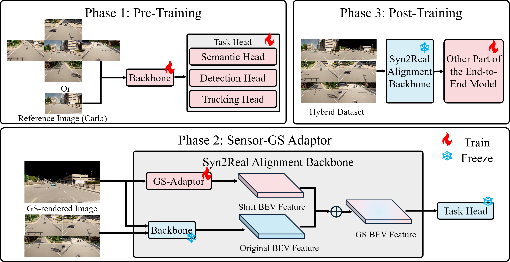

# From Infrastructure to Vehicle

**Cooperative Data Generation Based on Roadside Sensors for Intersection Safety Enhancement**

Lingfeng Qi · Guofa Li · Wenbo Chu · Qihong Xue · Jie Li · Keqiang Li

[Project webpage](https://huasa01.github.io/Infrastructure2Vehicle/) · [Repository](https://github.com/HUASA01/Infrastructure2Vehicle)

> **Release status:** The manuscript is under review. This repository currently contains the project overview and representative figures. The implementation is not yet released; the full release is planned upon formal acceptance.

## Overview

We study **offline roadside-to-vehicle data generation** for intersection perception. Given synchronized images from calibrated roadside cameras, the pipeline estimates metric depth, initializes and optimizes an instantaneous 3D Gaussian Splatting (3DGS) scene, and renders images at specified vehicle poses. A task-conditioned **Syn2Real Alignment (SRA) Backbone** helps GS-rendered and reference sensor-domain images share the same downstream vehicle-detection head.

The experiments use **CARLA simulation**. Both the reference sensor-domain observations and the scenes used for GS rendering originate from CARLA. The reported evidence concerns reconstruction and vehicle detection; real-world deployment and direct safety-risk validation remain future work.

*Method overview from the manuscript. Metric-depth estimation and 3DGS produce target vehicle views; the SRA path adapts their task-relevant features for downstream perception.*

## Method

1. **Metric-depth estimation:** Predict geometrically scaled depth from synchronized, calibrated roadside images.
2. **Instantaneous scene reconstruction:** Back-project the depth estimates to initialize a 3DGS scene, then optimize it against the roadside images for each timestamp independently.
3. **Vehicle-view rendering:** Render the reconstructed scene at a specified target vehicle pose.
4. **Task-conditioned feature adaptation:** Use the SRA Backbone to make rendered samples compatible with the downstream detection task.

The SRA training protocol has three phases:

| Phase | Trainable modules | Frozen modules | Data |
| --- | --- | --- | --- |
| 1: Reference-domain pre-training | Base backbone and detection head | — | Reference sensor-domain CARLA images |
| 2: GS-adaptor training | GS adaptor | Base backbone and detection head | GS-rendered CARLA images |
| 3: Downstream-head training | Detection head | Base backbone and GS adaptor | Hybrid reference and GS-rendered CARLA images |

*The experiments evaluate vehicle detection. Semantic and tracking heads in the schematic indicate possible uses, rather than additional evaluated tasks.*

## Representative vehicle view

| Reference sensor-domain image (CARLA) | GS-rendered image |
| :---: | :---: |
|  |  |

*The example is taken from the manuscript. Content outside roadside-camera coverage can be missing, and objects near occlusion boundaries can be distorted.*

## Reported results

The following values are reported in the current revised manuscript. They are presented as research results; this page does not yet provide executable reproduction materials.

### Reconstruction

The fixed benchmark contains 200 reconstructed CARLA timestamps. PSNR is in dB; higher PSNR and SSIM are better, and lower LPIPS is better.

| Evaluation views | PSNR ↑ | SSIM ↑ | LPIPS ↓ |
| --- | ---: | ---: | ---: |
| Original roadside views | 24.48 | 0.92 | 0.10 |
| Target vehicle views | 10.03 | 0.42 | 0.66 |

The reported complete reconstruction time is **91.48 seconds per timestamp** on a single NVIDIA GeForce RTX 4090D. This includes metric-depth inference, Gaussian initialization, and 512 optimization steps. The pipeline is intended for offline dataset generation.

### Hybrid-data training

In the non-cooperative vehicle-detection setting, Phase 3 freezes the SRA Backbone and trains the detection head. Both conditions below are validated on the same reference sensor-domain CARLA dataset.

| Training condition | Training samples | Synthetic ratio | BEV mAP@0.5 (%) ↑ | BEV mAP@0.7 (%) ↑ |
| --- | ---: | ---: | ---: | ---: |
| Small reference-only dataset | 2,019 | 0 | 44.58 ± 0.76 | 25.14 ± 0.89 |
| Larger hybrid dataset | 4,128 | 0.4 | 65.54 ± 0.67 | 50.76 ± 0.81 |

Values are mean ± sample standard deviation over three runs with seeds 0, 1, and 2. The synthetic ratio is the number of synthetic samples divided by the total number of reference and synthetic samples. Because dataset size also changes, this comparison evaluates dataset expansion rather than a strict single-variable ablation of the synthetic ratio.

### Unseen-intersection reconstruction

These evaluations exclude target-intersection images from depth-network training. PSNR is in dB.

| Unseen intersection | Original-view PSNR / SSIM | Vehicle-view PSNR / SSIM |
| --- | ---: | ---: |
| B | 21.66 / 0.89 | 7.79 / 0.23 |
| C | 24.37 / 0.92 | 8.60 / 0.36 |

These are the reported evaluation values; no repeated-run uncertainty estimate is provided for these rows. They are distinct from the manuscript's original B/C evaluations using retrained depth models.

## Scope and limitations

- Evaluation is limited to CARLA intersections and the stated reconstruction and detection protocols.
- Large viewpoint changes can expose unobserved regions and produce holes or object distortions.
- Reconstruction is performed independently at each timestamp; the reported implementation is an offline data-generation pipeline.
- Task-conditioned feature adaptation provides empirical detection compatibility rather than a guarantee that feature distributions are identical.
- Real-world deployment, direct safety outcomes, and probabilistic uncertainty calibration have not been established by these experiments.

## Release plan

The source code, experiment configurations, figure-generation and analysis scripts, and reproduction guidance will be released through the public GitHub repository upon acceptance. The release will include the CARLA synthetic data and/or the corresponding data-generation scripts.

| Material | Current status |
| --- | --- |
| Method overview, representative figures, and selected reported results | Included in this project page |
| Method implementation and experiment configurations | Planned for release upon acceptance |
| Figure-generation and analysis scripts | Planned for release upon acceptance |
| Reproduction guidance | Planned for release upon acceptance |
| CARLA synthetic data and/or data-generation scripts | Planned for release upon acceptance |

The current project page does not provide an executable implementation or a complete reproducibility package.
