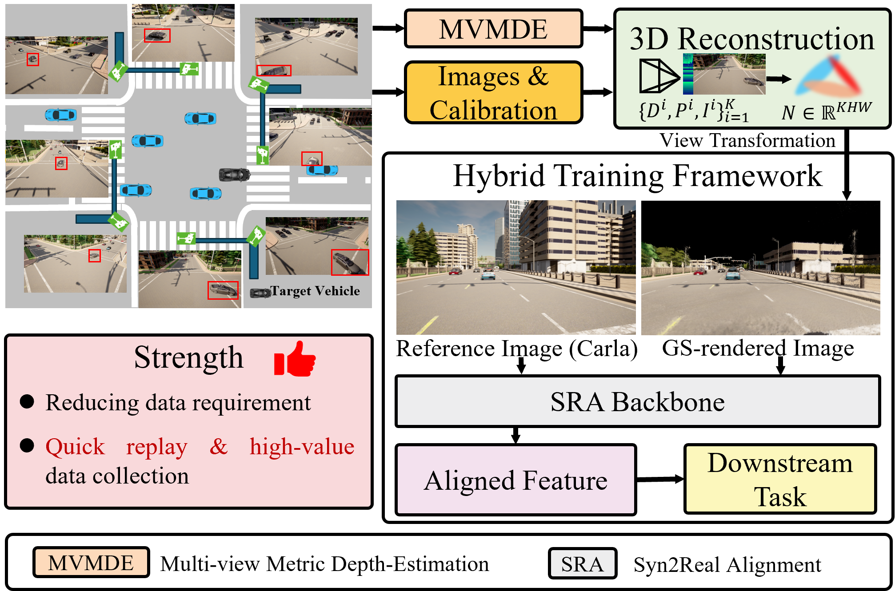
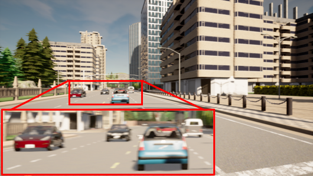
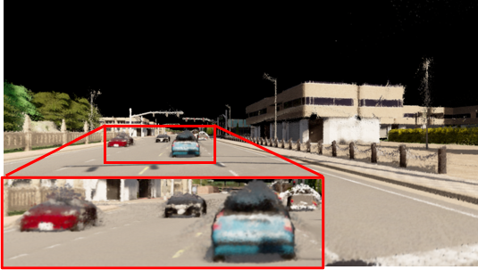

# From Infrastructure to Vehicle

**Cooperative Data Generation Based on Roadside Sensors for Intersection Safety Enhancement**

Lingfeng Qi · Guofa Li · Wenbo Chu · Qihong Xue · Jie Li · Keqiang Li

[Project webpage](https://huasa01.github.io/Infrastructure2Vehicle/) · [Repository](https://github.com/HUASA01/Infrastructure2Vehicle)

> **Release status:** The manuscript is under review. This repository currently contains the project overview and representative figures. The implementation is not yet released; the full release is planned upon formal acceptance.

## Overview

We study **offline roadside-to-vehicle data generation** for intersection perception. Given synchronized images from calibrated roadside cameras, the pipeline estimates metric depth, initializes and optimizes an instantaneous 3D Gaussian Splatting (3DGS) scene, and renders images at specified vehicle poses. A task-conditioned **Syn2Real Alignment (SRA) Backbone** helps GS-rendered and reference sensor-domain images share the same downstream vehicle-detection head.

The experiments use **CARLA simulation**. Both the reference sensor-domain observations and the scenes used for GS rendering originate from CARLA. The reported evidence concerns reconstruction and vehicle detection; real-world deployment and direct safety-risk validation remain future work.

*Method overview from the manuscript. Metric-depth estimation and 3DGS produce target vehicle views; the SRA path adapts their task-relevant features for downstream perception.*

## Representative vehicle view

| Reference sensor-domain image (CARLA) | GS-rendered image |
| :---: | :---: |
|  |  |

*The example is taken from the manuscript. Content outside roadside-camera coverage can be missing, and objects near occlusion boundaries can be distorted.*

## Release plan

The source code, experiment configurations, figure-generation and analysis scripts, and reproduction guidance will be released through the public GitHub repository upon acceptance. The release will include the CARLA synthetic data and/or the corresponding data-generation scripts.

| Material | Current status |
| --- | --- |
| Project overview and representative figures | Included in this project page |
| Method implementation and experiment configurations | Planned for release upon acceptance |
| Figure-generation and analysis scripts | Planned for release upon acceptance |
| Reproduction guidance | Planned for release upon acceptance |
| CARLA synthetic data and/or data-generation scripts | Planned for release upon acceptance |

The current project page does not provide an executable implementation or a complete reproducibility package.
